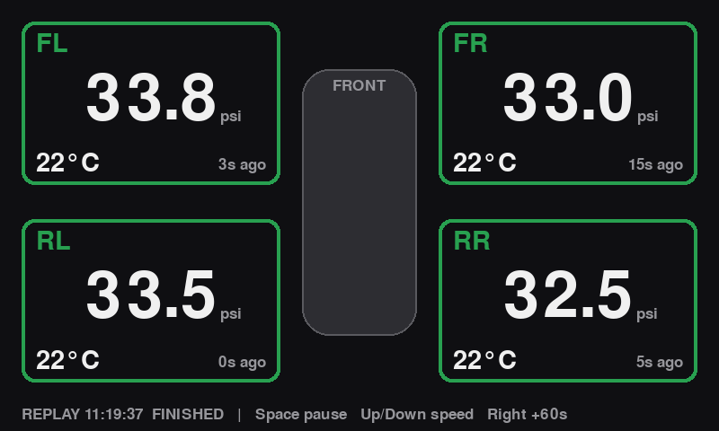

# FR-S TPMS Monitor

Read your car's factory tire pressure sensors with a cheap software-defined radio and
show live pressure and temperature for all four tires.

Built and tested on a 2013 Scion FR-S (315 MHz sensors). It should work on any car whose
TPMS sensors [rtl_433](https://github.com/merbanan/rtl_433) can decode.



## Features

- Live 4-corner display of pressure (psi) and tire air temperature (°C)
- Colour-coded warning and alarm limits, plus grey-out when a sensor goes quiet
- Ignores every TPMS sensor except your own four
- Logs each session to CSV
- Replays a saved log as if it were live (pause, speed up, skip)
- Demo mode for testing without hardware

## Hardware

**Tire monitoring (works today):**

| Part | Notes |
|---|---|
| RTL-SDR dongle | Tested with the RTL-SDR Blog V3 |
| Antenna | Telescopic, set to ~24 cm (quarter wave at 315 MHz) |
| Computer | Windows laptop or Linux machine |

**Full in-car dash (in progress):**

| Part | Role |
|---|---|
| LILYGO T-CAN485 (ESP32) + OBD-II splitter + OBD pigtail | Reads engine data from the CAN bus (listen-only) and sends it over Wi-Fi |
| Raspberry Pi 3 B+ in a Flirc aluminium case | Runs rtl_433, collects engine data, logs, hosts the Wi-Fi hotspot and dashboard |
| RTL-SDR on a short USB extension | Tire sensors, plugged into the Pi |
| onn. 7" Android tablet (or any phone/tablet with a browser) | Displays the dashboard |
| 4-port USB car charger + cables | Powers the ESP32, Pi and tablet |

Full parts list with links and prices: [`docs/bom.md`](docs/bom.md).

## Setup (Windows)

1. **Driver:** plug in the dongle, run [Zadig](https://zadig.akeo.ie), choose
   *Options → List All Devices*, select **Bulk-In, Interface (Interface 0)**
   (USB ID `0BDA 2838`) and install **WinUSB**.
2. **rtl_433:** download the Windows x64 zip from the
   [rtl_433 releases](https://github.com/merbanan/rtl_433/releases) and extract it into
   this folder, or anywhere on your PATH.
3. **Python:** install Python 3.15 (tested), then install
   [pygame-ce](https://pyga.me), the community edition of pygame:
   ```powershell
   py -m pip install -r requirements.txt
   ```
   Use pygame-ce rather than the original `pygame` package, which has no Windows build
   for newer Python versions. The code doesn't change: pygame-ce still uses `import pygame`.
4. **Sensor IDs:** copy `sensors.example.json` to `sensors.json` and fill in your IDs
   (see below).

## Finding your sensor IDs

1. Run `rtl_433 -f 315M -M level -F json` with the antenna near the car.
2. Let 2–3 psi out of **one** tire quickly (press the valve core for a few seconds).
   The sensor detects the drop and transmits within about 30 s.
3. Note the `id` that appears, then re-inflate. Repeat for each wheel.
4. Put the IDs in `sensors.json`:
   ```json
   { "FL": "xxxxxxxx", "FR": "xxxxxxxx", "RL": "xxxxxxxx", "RR": "xxxxxxxx" }
   ```

`sensors.json` is git-ignored. Sensor IDs are unique to your car, so keep them out of the repo.

## Usage

```powershell
py tpms_dash.py                    # live
py tpms_dash.py --demo             # fake data, no dongle needed
py tpms_dash.py --replay samples/2026-10-21_morning_drive.csv --speed 10
```

| Key | Action |
|---|---|
| F | Toggle fullscreen |
| Esc / Q | Quit |
| Space | Pause / resume (replay) |
| Up / Down | Double / halve replay speed |
| Right | Skip 60 s (replay) |

Limits (psi and temperature), the radio frequency and the stale timeout are set at the
top of `tpms_dash.py`.

## Logs

Each live session writes `logs/tpms_YYYYMMDD_HHMMSS.csv`:

| Column | Meaning |
|---|---|
| time | Local time of the reading |
| corner | FL / FR / RL / RR |
| id | Sensor ID |
| psi | Pressure (psi) |
| temp_c | Air temperature inside the tire (°C) |
| status | Raw sensor status byte (see `docs/sensor-notes.md`) |
| alert_mode | 1 if the sensor reports a pressure change |
| snr, rssi | Signal quality (dB) |
| model | rtl_433 decoder name |

## Notes

- Sensors transmit about once a minute while driving and less often when parked, so
  expect a short wait before all four corners appear.
- The temperature is the air inside the tire, not the tread surface.
- See [`docs/sensor-notes.md`](docs/sensor-notes.md) for protocol findings and timing.

## Roadmap

- [ ] Tune warning limits for street and track pressures
- [ ] Tread surface temperature with IR sensors
- [ ] Engine data from OBD/CAN (RPM, speed, coolant, oil temp, throttle, brake, wheel speeds), likely through an ESP32 CAN node
- [ ] A Raspberry Pi 3 B+ in the car that collects everything and serves the dashboard
- [ ] The dashboard as a web page on a tablet or phone
- [ ] In-car mounting and power (12 V supply, auto-start, mount)
